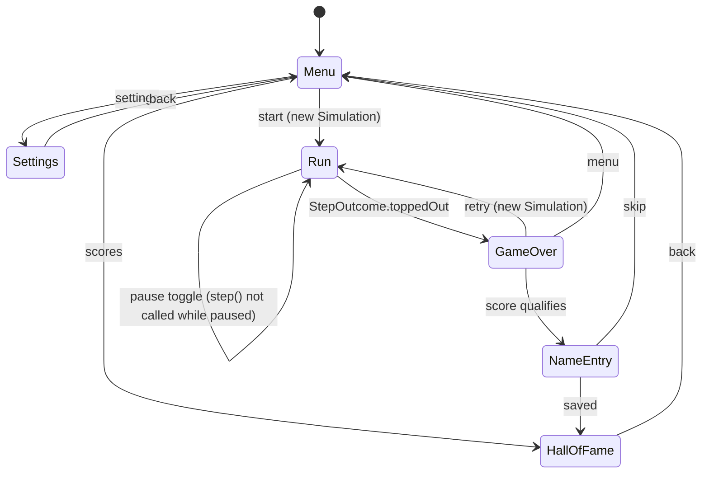
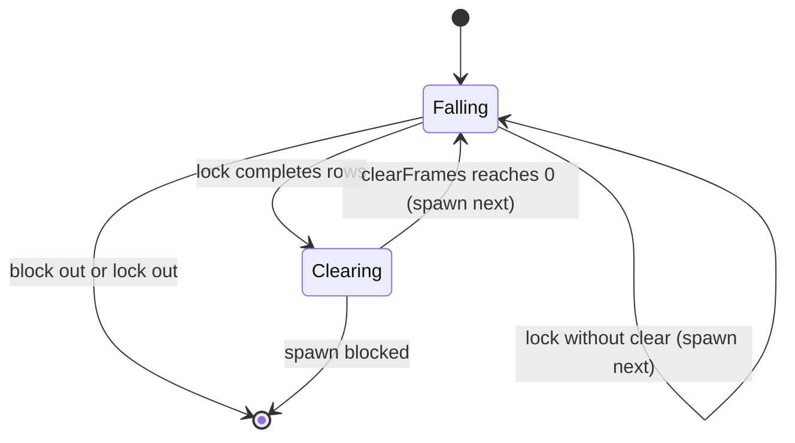

# Scene state machine (SceneMachine)

Brick 5 builds only `Run`, `Paused` (the pause toggle drawn as a self-loop above becomes an explicit state) and `GameOver` with its retry; the menus, name entry and hall of fame arrive in brick 6.

The piece phases (`Falling`, `Clearing`) live inside `Simulation` and are counted in fixed steps,
so pause, replays and display refresh rate never change gameplay timing.

