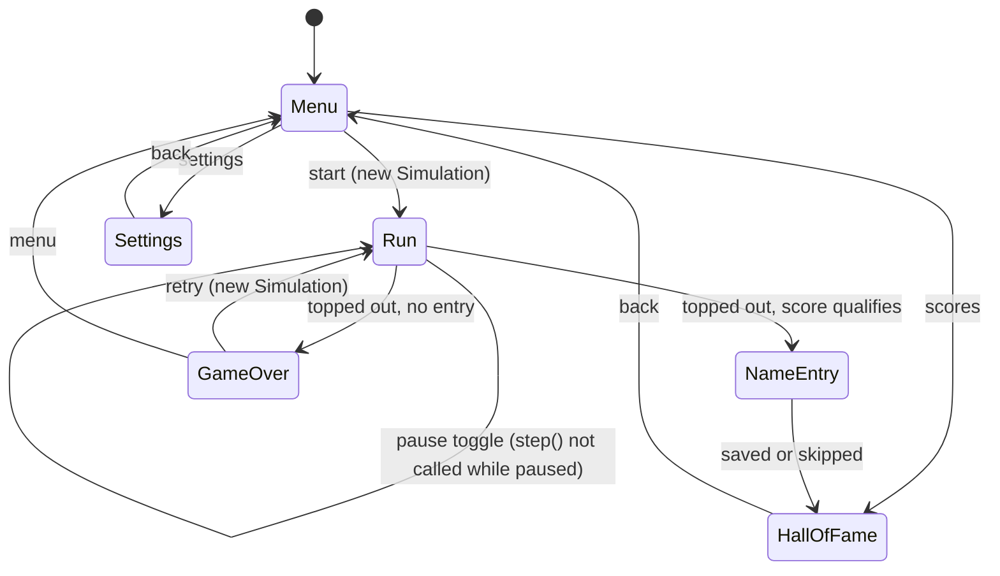
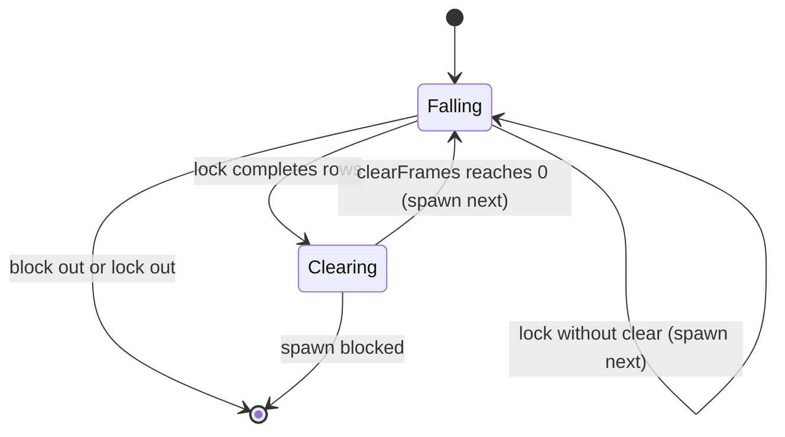

# Scene state machine (SceneMachine)

Brick 6 builds every state (see system/04-class-brick6). `Paused` and `GameOver` are states of `RunScene`; a qualifying run goes straight to `NameEntry` (the game over sound still plays).

The piece phases (`Falling`, `Clearing`) live inside `Simulation` and are counted in fixed steps,
so pause, replays and display refresh rate never change gameplay timing.

