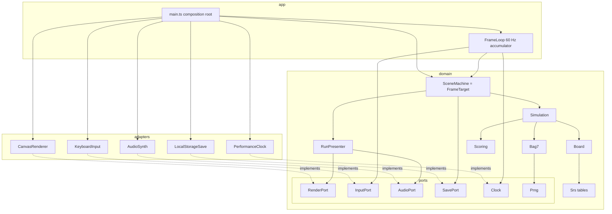

# Components

Dependency rule: `domain` imports nothing from the browser. Adapters implement the domain ports;
only `app/main.ts` (composition root) touches `window` / `document` and wires adapters in.
The frame loop is generic (copied from retro-shmup, ADR-0002): it drives a `FrameTarget` and knows
nothing about the game.

- `SceneMachine` creates a new `Simulation` per run and per retry.
- The seed is drawn in `main.ts` and recorded with the score, which enables replays (as retro-shmup ADR-0019).
