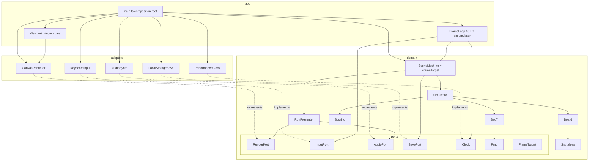

# Components

Dependency rule: `domain` imports nothing from the browser. Adapters implement the domain ports;
only `app/main.ts` (composition root) touches `window` / `document` and wires adapters in.
The frame loop is generic (copied from retro-shmup, ADR-0002): it drives a `FrameTarget` and knows
nothing about the game.

- `SceneMachine` creates a new `Simulation` per run and per retry.
- The seed is drawn in `main.ts` and recorded with the score, which enables replays (as retro-shmup ADR-0019).

## Brick 5 (engine and render) deltas

- `FrameTarget` (the loop's only view of the game) is a domain port, so `SceneMachine` implements it without importing `app/`.
- `SavePort` and its adapter stay in the diagram but are built in brick 6 (hall of fame): nothing persists in brick 5.
- `AudioPort` ships with a silent default (`SILENT_AUDIO`); `AudioSynth` is built in brick 6.
- Lint rule added: an adapter imports only `domain/ports/**` (never another domain module) and never `app/`. The `Intent` flags and `IntentFrame` therefore move to `domain/ports/input-port.ts`.
- `Viewport` (integer scale from the window size) lives in `app/` and feeds the renderer; `main.ts` calls it on `resize`.
