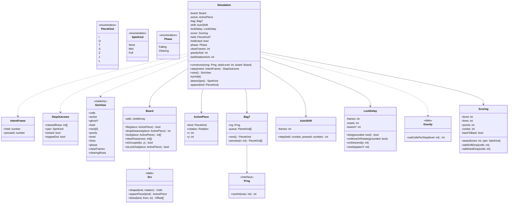

# Domain classes

All classes live in `src/domain/` and import nothing from the browser. Randomness comes from an
injected seeded `Prng`; time is counted in fixed 60 Hz steps (no wall clock).

Board: 10 × 40 cells (Guideline buffer), `x` 0..9 left to right, `y` 0..39 **bottom to top**.
Rows 0–19 are visible. Pieces spawn occupying rows 20–21, so SRS rotations near the top never
leave the buffer.

## Rules carried by the model

- **Construction:** `board` defaults to an empty `Board`; tests pass a prepared one. `StepOutcome` and `SimView` are reused objects: read them before the next `step` / `view`.
- **Combo:** `combo` counts consecutive clearing locks; the bonus is 50 × (combo − 2) × level: 0 on the 2nd clearing lock, 50 × level on the 3rd. `AutoShift` DAS 10 / ARR 2 and `LockDelay` 30 frames / 15 resets are module constants.
- **Input:** `IntentFrame` bit flags (Left, Right, SoftDrop, HardDrop, RotateCw, RotateCcw, Hold,
  Pause), `held` and `pressed` as in retro-shmup's input port. Rotate, hard drop and hold fire on
  `pressed` only. `AutoShift` returns −1, 0 or +1 cells for this step (DAS 10, ARR 2).
- **Step order:** hold → rotate → shift → hard / soft drop → gravity → lock. During `Clearing` the
  step only counts `clearFrames` down (20 steps), then spawns the next piece and checks top-out.
  Pause is handled by `SceneMachine`, which simply stops calling `step()`.
- **Board bounds:** `fits()` is false when a cell is outside the 10 × 40 board. `isOccupied()` returns true
  outside the board (used by the T-spin corner rule).
- **Line clear:** `lock()` writes the piece and returns the completed rows (ascending) without removing
  them, so the renderer can flash them during `Clearing`; `clearRows()` removes them and drops the
  rows above once the 20 steps have elapsed.
- **Reuse:** `lock()`, `Bag7.preview()` and `Srs` return shared arrays (no allocation in the loop):
  read them before the next call, never mutate them. `Board` size lives in `board-size.ts`.
- **Spawn:** `spawnPiece(kind)` puts the box at x = 3, y = 19: every piece lies within rows 20–21 (I only on row 21), centred.
- **Top-out:** block out = the spawned piece does not fit; lock out = `isLockOut()` (every cell at
  y ≥ 20).
- **Gravity:** integer fixed point, 256 sub-cells per cell; precomputed Guideline curve for levels 1–15, held at level 15 beyond. Soft drop multiplies the level value by
  20 at the call site and scores 1 point per cell descended.
- **Lock delay:** `onMoveOrRotate` is called only after a *successful* move or rotation, and counts
  only when grounded, and restarts the countdown for the first 15 times only; after that the
  countdown runs out. `onDescend(y)` resets frames and resets when y is a new lowest row.
  `tick` returns true when grounded and frames ≥ 30.
- **Hold:** `tryHold()` does nothing when `holdUsed`; otherwise swaps with `held` (empty → take
  `bag.next()`), respawns and sets `holdUsed`, cleared when the next piece locks.
- **T-spin:** T only. `lastRotationKick` is −1 (none), or 0 (no offset) … 4 (last SRS test), set by a successful
  rotation and cleared by any move or fall. Requires ≥ 3 of the 4 diagonal corners occupied;
  `Full` if both front corners are occupied or the kick was 4, otherwise `Mini`.
- **Bag:** `preview(n)` appends a new shuffled bag while the queue holds fewer than n pieces.
- **Clearing rows (brick 5):** `SimView.clearingRows` is the rows completed by the last lock while `phase` is Clearing (empty otherwise), so the presenter flashes them from the view alone. The array is the reused `Board.lock` array.
