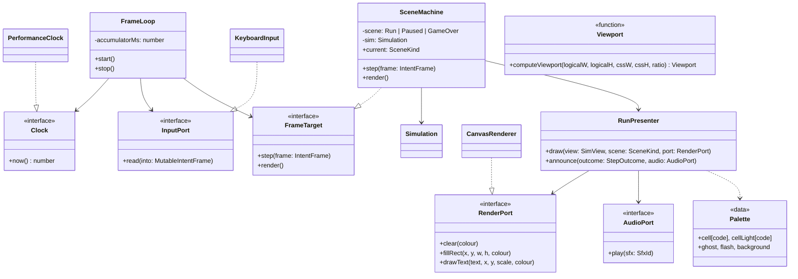

# Engine, presentation and adapter classes (brick 5)

Ports live in `src/domain/ports/`; presentation logic in `src/domain/presentation/` and
`src/domain/scenes/` (browser-free, tested with a fake `RenderPort`); adapters in `src/adapters/`
implement ports and import nothing else from the domain. `FrameLoop`, `Viewport` and `main.ts` live in `src/app/`.

## Logical screen (320 × 352 px, integer scale)

| Zone | Pixels | Content |
|---|---|---|
| Spawn margin | x 80–240, y 0–32 | rows 20–21 drawn faded |
| Playfield | x 80–240, y 32–352 | 10 × 20 cells of 16 px |
| Left panel | x 0–80 | HOLD box, then SCORE, LEVEL, LINES (3 × 5 bitmap font, 2×) |
| Right panel | x 240–320 | NEXT: 5 pieces in 12 px mini cells |
| Overlay | playfield | PAUSED or GAME OVER + "PRESS ENTER" on a dim layer |

The canvas is scaled by an integer factor (nearest neighbour, `computeViewport`: largest integer that fits, minimum 1, a smaller window scrolls).

## Rules carried by the model

- **Input port:** `Intent` flags and `IntentFrame` move to `ports/input-port.ts`, plus `Confirm` (256) used by the scenes only; `Simulation` ignores unknown bits. `read` fills the loop's single reused frame; `pressed` is latched until the next read.
- **Keyboard map (fixed, remapping is brick 6):** ← → move, ↓ soft drop, Space hard drop, ↑ / X rotate clockwise, Z rotate counter-clockwise, C / Shift hold, P / Esc pause, Enter confirm. Keys of the map never scroll the page. Focus loss clears the held keys.
- **FrameLoop:** copied from retro-shmup (ADR-0002): accumulator starts half a step full, a frame advances at most 250 ms, a step that stops the loop ends the tick. The time scale and the dt argument are dropped (fixed steps only).
- **SceneMachine (brick 5 subset):** Run → (pause) Paused → Run; Run → GameOver on `toppedOut`; GameOver → Run on Confirm with a new seed. While Paused, `step()` is not called on the `Simulation` and the frame still renders. The seed comes from an injected `() => number` (drawn in `main.ts`).
- **RunPresenter:** draws only from `SimView`, no allocation in `draw` (index loops, reused scratch). `active` is not drawn while `phase` is Clearing. The ghost uses `ghostY` and is skipped when it equals `active.y`. During Clearing, `clearingRows` flash (alternating every 4 steps from `clearFrames`).
- **Audio:** `announce` plays `lock`, `clear` (1 to 4 rows: `clear1`…), `spin`, `gameOver` through `AudioPort`; `main.ts` wires `SILENT_AUDIO` until brick 6.
- **Text:** the bitmap font is copied from retro-shmup and lives in the adapter; the port only takes strings (digits, A–Z, space, `-`); the presenter never passes another character.
- **Key with Cmd held:** `KeyboardInput.keyDown(code, repeat, meta)` ignores it and releases every key, because macOS sends no `keyup` for a key pressed under Cmd.
