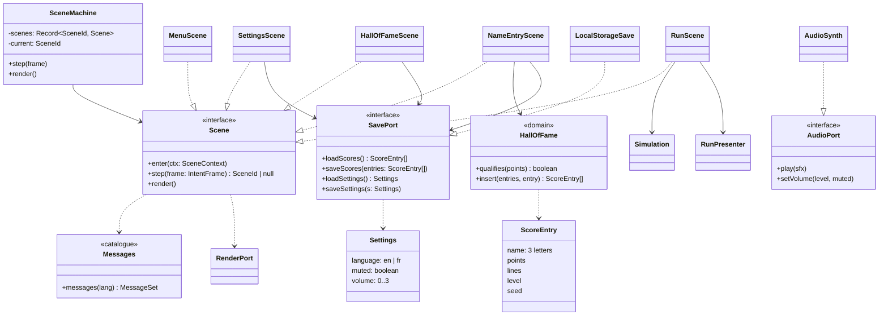
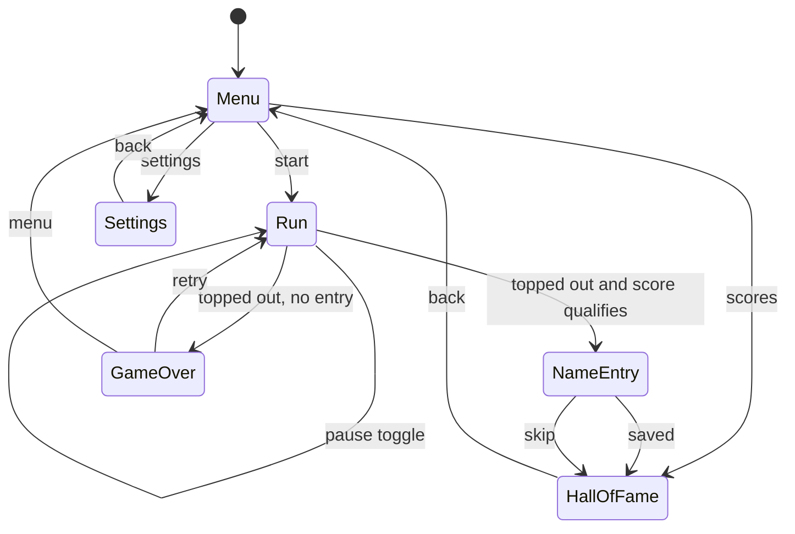

# Menus, Hall of Fame, i18n and audio classes (brick 6)

Decisions (owner-validated MCDA, issue #14): one `Scene` per screen with `SceneMachine` delegating
(415/500 vs extended switch 315); arcade three-letter name entry on the existing `Intent` flags
(480 vs typed text 300); EN/FR catalogue in unaccented capitals with the font unchanged (445 vs EN
only 385, accented font 345); WebAudio synthesis with no asset (450 vs samples 295).

## Rules carried by the model

- **Scene contract:** `step` returns the next `SceneId` or `null` to stay; `SceneMachine` calls `enter` on the target, passing a shared `SceneContext` (settings, last run result, seed source). Scenes never import each other.
- **Navigation inputs** reuse the existing flags: ↑ = RotateCw, ↓ = SoftDrop, ← → = Left / Right, Enter = Confirm, Esc / P = Pause (back). No `InputPort` change.
- **Menu:** START, SCORES, SETTINGS. **Settings:** language, volume (0–3), mute; every change is saved at once.
- **Run → GameOver** (kept, plus MENU choice): on Confirm, if `HallOfFame.qualifies(points)` go to NameEntry, else retry; Esc goes to Menu.
- **NameEntry:** three letters A–Z, ↑↓ change the letter, ←→ move the cursor, Enter on the last cell saves and goes to HallOfFame, Esc skips.
- **Hall of Fame:** top 10, ordered by points desc then insertion order; the seed is stored with the entry (replays later).
- **SavePort:** `loadScores` / `loadSettings` never throw: corrupt, missing or wrong-shaped JSON, or storage disabled, returns defaults (empty table, EN, volume 2, unmuted). `save*` swallows `QuotaExceededError` and storage errors. Stored shape is validated field by field (no cast); versioned key `retro-blocks.v1`.
- **i18n:** `messages(lang)` returns a typed `MessageSet` (every key in both languages, enforced by the type); text is capitals A–Z, digits, space, `-` only, so the font and the port are unchanged. A test checks that every string uses only supported characters. Default language: EN (no `navigator` read in the domain; `main.ts` may pass the browser language as the first-run default).
- **AudioSynth:** WebAudio `OscillatorNode` + gain envelope per `SfxId`; the `AudioContext` is created or resumed on the first key press (autoplay policy); `setVolume` scales the master gain; failure to create a context degrades to silence. Browser-free parts (the note table per sfx) are data in the adapter, tested by a fake context.
- **Lint:** adapters still import only `domain/ports/**`; `Settings` and `ScoreEntry` therefore live in `ports/save-port.ts`; `SceneId` stays in `scenes/`.
- **Out of scope:** key remapping (the brick 5 note "remapping is brick 6" is dropped: the map stays fixed).

## Scene states (replaces the brick 5 subset in gameplay/02-state)

Paused remains an explicit state inside `RunScene`; `GameOver` is an overlay state of `RunScene`.
